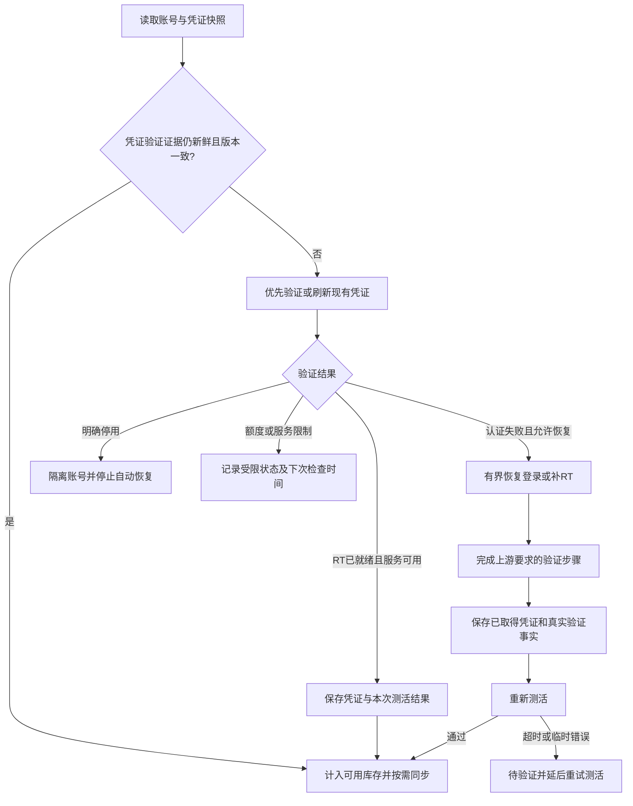

# 账号巡检、RT 获取与补库逻辑审查

审查日期：2026-11-11。范围：当前本地工作区的巡检、RT 补齐、短信控制器、补库调度、账号持久化和相关测试。

**建议把当前“接码库存”统一为“可用 RT 账号库存”。没有出现 add-phone、直接取得有效 RT 并通过测活，同样属于成功；短信验证应保留为独立的事实记录。** 当前最主要的问题是不同模块对“成功”的定义不一致，随后又被候选筛选和定时重试放大。

本报告以当前文件为依据，包含工作区内尚未提交的实现。本轮未重新连接生产服务器，未修改业务源代码或生产配置，未运行真实注册、租号、发码或账号测活。前面会话中查到的生产日志只用作历史样本，不能据此声称现在的库存、余额、任务数量仍然相同。

## 1. 当前实现怎样工作

| 路径 | 当前执行顺序 | 当前成功口径 | 关键代码 |
| --- | --- | --- | --- |
| 定时调度 | 检查巡检/补库间隔，调用相应 API 入队 | 成功创建任务与任务成功是两回事 | [scheduler.py:65](<D:/work/apps/项目/11_注册机/gpt/any-auto-register/core/scheduler.py:65>) |
| 账号巡检 | 按账号状态及可选短信标记筛选 → 测活 → 对可恢复认证错误重测 → 按设置补 RT → 再测活 → 上传 | 启用的各步骤完成，且认证通过上传门槛 | [inspection_service.py:506](<D:/work/apps/项目/11_注册机/gpt/any-auto-register/services/inspection_service.py:506>) |
| RT 补齐引擎 | 先复用会话做授权；没有拿到 RT 时，根据开关和密码再走协议登录 | 结果中有非空 RT，即 `BackfillResult.success=True`；引擎自身不做最终业务测活 | [rt_backfill.py:169](<D:/work/apps/项目/11_注册机/gpt/any-auto-register/platforms/chatgpt/rt_backfill.py:169>) |
| 自动补库 | 统计库存 → 优先选未接短信的旧账号 → 调补 RT → 保存结果 → 再按短信标记判断；没有就绪候选时创建注册子任务 | 正常账号状态 + 真实短信验证记录 | [sms_stock_service.py:109](<D:/work/apps/项目/11_注册机/gpt/any-auto-register/services/sms_stock_service.py:109>) |
| 新注册子任务 | 获取账号结果 → 保存账号 → 检查强制短信条件 → 自动上传 | 补库传入强制短信标记，无短信记录时即使已有 RT 也报失败 | [tasks.py:686](<D:/work/apps/项目/11_注册机/gpt/any-auto-register/api/tasks.py:686>) |
| 短信分支 | 碰到手机验证要求时租号、等待、验证；验证成功后写短信记录 | 短信验证成功只是一个步骤成功 | [auth_flow.py:1197](<D:/work/apps/项目/11_注册机/gpt/any-auto-register/platforms/chatgpt/protocol/auth_flow.py:1197>) |

“会话复用”不保证完全不登录：授权返回登录页时，该策略内部仍会推进登录并可能读邮箱验证码。因此日志中的“复用会话成功”描述的是外层策略，不能据此判断没有触发邮箱 OTP。依据：[rt_backfill.py:221](<D:/work/apps/项目/11_注册机/gpt/any-auto-register/platforms/chatgpt/rt_backfill.py:221>)、[auth_flow.py:1342](<D:/work/apps/项目/11_注册机/gpt/any-auto-register/platforms/chatgpt/protocol/auth_flow.py:1342>)。

目前值得保留的设计包括：网络请求期间尽量不持有数据库会话；非空凭证增量合并；补库具备单轮、连续失败和每日账号尝试上限；补库与其他 GPT 任务之间有入队互斥；巡检恢复后会重测并阻止认证失败的上传。需要在这些基础上修正边界，不必重写整套系统。

## 2. 首先统一业务口径

建议分别记录四个维度，不再让一个 `status` 或一个 `success` 同时承担所有含义。

| 维度 | 回答的问题 | 建议含义 |
| --- | --- | --- |
| 凭证获取结果 | 这次拿到 RT 了吗？ | RT 已取得、未取得、明确失效；记录获取/刷新时间 |
| 账号可用性 | 当前凭证是否可用于目标服务？ | 待验证、可用、暂时受限、待恢复、明确停用；带检查时间和凭证版本 |
| 短信事实 | 实际通过过短信验证吗？ | 如实保留 `sms_verification`，没有发生就不写成功 |
| 外部同步 | 最新凭证传过去了吗？ | 按目标分别记录待同步、成功、失败及凭证版本 |

建议的目标判定：

| 情况 | 凭证获取结果 | 库存处理 |
| --- | --- | --- |
| 无 add-phone，取得 RT，目标服务测活通过 | 成功 | 计入可用库存，无需短信标记 |
| 有 add-phone，完成必要验证，取得 RT，测活通过 | 成功 | 计入可用库存，并保留真实短信事实 |
| 拿到 RT，测活超时或临时网络错误 | 凭证已取得，验证未完成 | 保存凭证，进入待验证；重试测活，不立即重做注册 |
| 有短信记录但没有 RT | 短信步骤完成，RT 未就绪 | 进入凭证恢复候选，不计入 RT 库存 |
| RT/AT 明确被拒绝且允许恢复 | 待恢复 | 有界恢复并重测 |
| 明确停用/删除 | 不可用 | 隔离，停止自动恢复和上传 |
| 认证有效但额度耗尽/需要付费 | 凭证有效，服务受限 | 单独展示受限数量，不按认证失败反复重登 |

这里的“有效 RT”不能只用字符串非空判断。新 RT 由成功交换取得，可结合随后测活记录建立有效性证据；历史 RT 没有验证证据时应先做受控验证。已有 AT 的测活成功也不等于证明旧 RT 一定能刷新。应记录最近一次实际兑换/刷新的结果，避免为了计数每轮都重新登录。

建议以“凭证有效数量”和“当前可服务数量”同时展示容量。是否因短暂额度限制启动新增账号，应是独立策略，不能由一个泛化的失败结果自动触发。

## 3. 优先问题与修改建议

优先级含义：P0 为这次问题应最先修复的口径错误；P1 为随后的正确性、凭证保护和控制问题；P2 为性能与可观测性改进。

### P0：库存、候选和新注册交付沿用了错误的短信门槛

**已确认，并有离线复现。** `_in_stock()` 要求短信验证，但不要求 RT 或最新测活；`_pending()` 又把无短信标记且有凭证/密码的账号加入候选。因此，有 RT 且测活良好的账号仍然会反复入选，而只有短信标记、没有 AT/RT 的正常状态账号反而能入库。

证据：[sms_stock_service.py:109](<D:/work/apps/项目/11_注册机/gpt/any-auto-register/services/sms_stock_service.py:109>)、[sms_stock_service.py:163](<D:/work/apps/项目/11_注册机/gpt/any-auto-register/services/sms_stock_service.py:163>)、[sms_stock.py:73](<D:/work/apps/项目/11_注册机/gpt/any-auto-register/api/sms_stock.py:73>)、[tasks.py:690](<D:/work/apps/项目/11_注册机/gpt/any-auto-register/api/tasks.py:690>)。

建议建立共享的“RT 账号评估”函数，输出是否就绪、原因、是否需要恢复、下次检查时间。库存统计、候选筛选、补库结果、新注册结果统一调用；账户详情中的短信事实仍按原意展示。单独改报错文案、给无短信账号伪造标记、把所有邮箱账号排除，都不能解决这个问题。

现有测试明确要求“RT 成功、无短信不计数”，所以代码通过测试不代表符合新业务口径。修改时应更新这组断言，并保留“实际通过短信验证才写标记”的测试。证据：[test_sms_stock.py:133](<D:/work/apps/项目/11_注册机/gpt/any-auto-register/tests/test_sms_stock.py:133>)、[test_sms_stock.py:285](<D:/work/apps/项目/11_注册机/gpt/any-auto-register/tests/test_sms_stock.py:285>)。

还要同步处理巡检的 `only_sms_verified` 过滤。此前服务器样本开启了这个选项，会漏掉无短信但已有 RT 的账号；改库存而保留该筛选，维护范围仍不一致。依据：[inspection_service.py:317](<D:/work/apps/项目/11_注册机/gpt/any-auto-register/services/inspection_service.py:317>)。这是配置迁移事项，本轮没有更改线上配置。

### P1：新凭证可能在停止或后续测活异常时丢失

**两个独立场景均已离线复现。**

1. 巡检补 RT 返回成功后，先检查停止/跳过，再保存。如果此时用户点停止，新的 RT 和已完成的短信事实没有落库。
2. 测活自动刷新成功后，新 AT/RT 已写进内存快照；随后 Codex 测活抛出超时异常，外层保存函数没有执行，数据库仍留旧凭证。若服务端已经轮换 RT，后续恢复风险更大。

证据：[inspection_service.py:480](<D:/work/apps/项目/11_注册机/gpt/any-auto-register/services/inspection_service.py:480>)、[inspection_service.py:526](<D:/work/apps/项目/11_注册机/gpt/any-auto-register/services/inspection_service.py:526>)、[status_probe.py:505](<D:/work/apps/项目/11_注册机/gpt/any-auto-register/platforms/chatgpt/status_probe.py:505>)。

建议把“已取得凭证的可靠保存”与“后续测活/同步是否成功”分开。停止应阻止下一次外部动作，同时保存本次已取得的成果；测活应返回包含凭证增量和探测错误的结构化结果，或通过明确的凭证提交回调保存。使用凭证版本防止旧快照覆盖新值，不要在 `finally` 无条件回写整份旧快照。

### P1：补 RT 与测活混用了账号、订阅和停用状态

**已离线复现。** 补 RT 成功后直接把主状态写成 `registered`，包括原先的 `trial`、`subscribed`；这会抹掉原有订阅标签。补库自身又没有后置测活，不能把拿到 RT 等同于账号已确认恢复。

证据：[chatgpt_rt_backfill.py:151](<D:/work/apps/项目/11_注册机/gpt/any-auto-register/services/chatgpt_rt_backfill.py:151>)、[sms_stock_service.py:175](<D:/work/apps/项目/11_注册机/gpt/any-auto-register/services/sms_stock_service.py:175>)。

另一个边界是：引擎只要结果已有 RT 就提前返回，而明确停用分类在后面执行。模拟“RT 已取得、末段抛明确停用错误”时，结果仍为成功、`account_deleted=False`。这是可复现的边界缺陷，尚无证据证明它导致了此前生产失败。依据：[rt_backfill.py:203](<D:/work/apps/项目/11_注册机/gpt/any-auto-register/platforms/chatgpt/rt_backfill.py:203>)。

建议先保存凭证增量，保持订阅维度；主可用状态由新的探测结果更新，明确停用信号优先。长期把订阅计划和认证状态分成不同字段。

### P1：刷新后仍沿用刷新前的 Account ID

**已离线复现。** `account_id` 在刷新凭证之前解析，刷新后没有重新计算。原账号没有 ID，但新 AT 带有 ID 时，认证已恢复，本次 Codex 探测仍报“缺少 Chatgpt-Account-Id”，甚至不会执行 Codex 请求。

证据：[status_probe.py:427](<D:/work/apps/项目/11_注册机/gpt/any-auto-register/platforms/chatgpt/status_probe.py:427>)、[status_probe.py:505](<D:/work/apps/项目/11_注册机/gpt/any-auto-register/platforms/chatgpt/status_probe.py:505>)、[status_probe.py:550](<D:/work/apps/项目/11_注册机/gpt/any-auto-register/platforms/chatgpt/status_probe.py:550>)。

建议凭证变化后重新解析并更新本次结果使用的 ID；同时明确 ID 来自账号字段、ID token 还是 AT，避免错误来源长期遮盖新值。

### P1：健康账号仍可能每轮重拿 RT，失败候选会重复排队

**代码行为已确认，生产复现次数本轮未重新统计。** 当巡检开启补 RT 且 `only_missing_rt=False`，即使首次测活通过、已有 RT，也会执行补 RT。此前服务器查询样本就是这个配置。补库则按 ID 升序选旧账号，冷却结束后没有“已经达成 RT 目标”的退出条件。

证据：[inspection_service.py:569](<D:/work/apps/项目/11_注册机/gpt/any-auto-register/services/inspection_service.py:569>)、[sms_stock_service.py:91](<D:/work/apps/项目/11_注册机/gpt/any-auto-register/services/sms_stock_service.py:91>)、[sms_stock_service.py:146](<D:/work/apps/项目/11_注册机/gpt/any-auto-register/services/sms_stock_service.py:146>)。

建议日常巡检优先验证现有凭证，有明确恢复需求才补 RT；强制重新获取作为一次性操作。候选按“待验证 → 可恢复 → 到期重试”区分，按下次尝试时间和最近处理时间公平选取。

需要纠正此前的绝对说法：这些邮箱账号并非“永远无法接码”，程序也并非“永远轮不到新注册”。上游是否要求手机验证会变化；所有旧候选在冷却中时，当前代码也会转到新注册。问题是成功口径不一致造成重复工作，以及“没有就绪旧候选”和“没有旧账号可恢复”没有区分。依据：[sms_stock_service.py:219](<D:/work/apps/项目/11_注册机/gpt/any-auto-register/services/sms_stock_service.py:219>)。

### P1：余额不足被当作换号错误重试，每日限额也不等于费用限额

**已离线复现。** 模拟接码平台持续返回 `NO_BALANCE`，配置 3 次号码尝试时，实际调用了 6 次模拟租号接口：每轮 V2 一次、V1 一次。更外层还有其他策略，不能把“处理一个账号”理解为“最多租一次号码”。

证据：[sms_service.py:575](<D:/work/apps/项目/11_注册机/gpt/any-auto-register/services/sms_service.py:575>)、[auth_flow.py:1091](<D:/work/apps/项目/11_注册机/gpt/any-auto-register/platforms/chatgpt/protocol/auth_flow.py:1091>)、[sms_stock_service.py:81](<D:/work/apps/项目/11_注册机/gpt/any-auto-register/services/sms_stock_service.py:81>)。

建议按错误类型处理：余额不足、无效密钥等服务商级错误停止租号重试并进入服务商冷却；短暂网络错误有限重试；只有确属号码问题才考虑另一个号码。每日账号尝试数、租号请求数、成功租号数、结算金额应分开记录。余额检查仅作为提示，租号实际返回和结算仍是最终依据。

此前查到余额 `0.066`，不能单独推导为“余额为零”或“现在所有号码都租不到”；当时日志中的 `NO_BALANCE` 才能证明那些请求被平台按余额问题拒绝。本轮没有实际租号验证价格或结算规则。

### P1：短信等待链没有完整接入停止控制

**静态确认，未进行真实长时间收码。** 外层和邮箱轮询支持 `task_control`，短信 controller 没有接收该控制器；短信等码循环使用普通休眠，获取号码前的锁也是阻塞等待。关闭补库会设置停止标记，但不会立即终止已进入短信循环的处理，循环还可能继续后续号码尝试。

证据：[sms_service.py:705](<D:/work/apps/项目/11_注册机/gpt/any-auto-register/services/sms_service.py:705>)、[sms_service.py:923](<D:/work/apps/项目/11_注册机/gpt/any-auto-register/services/sms_service.py:923>)、[sms_service.py:950](<D:/work/apps/项目/11_注册机/gpt/any-auto-register/services/sms_service.py:950>)。

建议停止控制贯穿 controller/provider；每次准备租号、发码、轮询及更换号码前检查，休眠和锁等待可中断。`TaskInterruption` 必须先于通用 `Exception` 重新抛出，避免被降级成普通失败继续推进。保留已完成结果，未完成激活由清理逻辑处理，并区分“发出取消请求”和“平台确认取消/退款”。

### P1：巡检与手动补 RT 缺少同账号执行互斥

**入口允许并行已由代码确认，实际凭证覆盖概率需要并发测试。** 补库与其他任务的互斥较完整；巡检主要阻止另一巡检和补库，手动补 RT 主要阻止补库。共享入队锁只保护创建动作，不能阻止两个已创建任务同时刷新同一账号。

证据：[inspection.py:81](<D:/work/apps/项目/11_注册机/gpt/any-auto-register/api/inspection.py:81>)、[tasks.py:1106](<D:/work/apps/项目/11_注册机/gpt/any-auto-register/api/tasks.py:1106>)、[chatgpt_sync.py:236](<D:/work/apps/项目/11_注册机/gpt/any-auto-register/services/chatgpt_sync.py:236>)。

建议对会轮换凭证的操作按 `account_id` 加执行锁或任务租约，落库带凭证版本比较。先保障单进程正确性；未来若多实例部署，再把租约和限额的原子更新放到数据库。

### P2：异常提示沿用旧测活结果，任务完成与成功容易混淆

**旧结果误导提示已离线复现。** 第一次测活通过，补 RT 后重测抛超时，`probe` 仍是第一次的有效结果，最终提示却是“恢复后认证未通过：auth=access_token_valid, codex=usable”。实际应显示“后置测活超时，结果待确认”，不能拿旧状态解释新失败。

证据：[inspection_service.py:526](<D:/work/apps/项目/11_注册机/gpt/any-auto-register/services/inspection_service.py:526>)、[inspection_service.py:599](<D:/work/apps/项目/11_注册机/gpt/any-auto-register/services/inspection_service.py:599>)。

批量巡检的 `done` 表示流程跑完，即使存在账号失败也会写 `done`；接码补库又采用另一套终态规则。监控应读取成功/失败数量，或增加“部分成功”结果字段，不能只看 `done`。依据：[tasks.py:976](<D:/work/apps/项目/11_注册机/gpt/any-auto-register/api/tasks.py:976>)。

建议每次测活产生独立结果对象，保留错误阶段、错误类型和本次检查时间。账号就绪、RT 恢复、上传结果分别统计；上传失败优先只重试上传。

### P2：任务状态页扫描全部历史，逐条日志重写整份任务

**静态确认，未做生产性能压测。** 状态 API 先取所有任务，解析每条完整日志，再筛选并截取 20 条；写日志则每追加一条就序列化并提交整个任务快照。长日志、多任务并发时，会增加 SQLite 写入与状态页读取开销。

证据：[tasks.py:204](<D:/work/apps/项目/11_注册机/gpt/any-auto-register/api/tasks.py:204>)、[tasks.py:271](<D:/work/apps/项目/11_注册机/gpt/any-auto-register/api/tasks.py:271>)、[tasks.py:407](<D:/work/apps/项目/11_注册机/gpt/any-auto-register/api/tasks.py:407>)、[sms_stock.py:59](<D:/work/apps/项目/11_注册机/gpt/any-auto-register/api/sms_stock.py:59>)、[inspection.py:266](<D:/work/apps/项目/11_注册机/gpt/any-auto-register/api/inspection.py:266>)。

建议数据库按任务来源、时间和数量过滤，只返回摘要列；日志按任务按需分页或增量读取；日志持久化短批次提交，关键凭证和终态立即提交。再根据压测决定 SQLite WAL/busy_timeout 等调整，不把它们当作并发覆盖的替代方案。

### P1：诊断日志包含可直接使用的敏感字段

**静态确认，前面服务器样本也出现过带用户名密码的代理地址。** 任务日志直接写代理 URL；短信日志写完整验证码；2FA 绑定还会把 TOTP 密钥写进通用日志。这些内容随后进入持久化任务日志和容器输出。

证据：[tasks.py:897](<D:/work/apps/项目/11_注册机/gpt/any-auto-register/api/tasks.py:897>)、[sms_service.py:1051](<D:/work/apps/项目/11_注册机/gpt/any-auto-register/services/sms_service.py:1051>)、[tasks.py:1075](<D:/work/apps/项目/11_注册机/gpt/any-auto-register/api/tasks.py:1075>)。

建议日志入口统一脱敏代理密码、令牌、验证码和邮箱身份；2FA 密钥通过有权限检查的专用一次性显示/导出流程交付。日志保留任务 ID、账号 ID、阶段、HTTP 状态及错误码，足以诊断且便于并发关联。历史日志是否清理要另定保留方案，本轮没有删除数据。

## 4. 建议的统一执行流程

短信验证只在上游实际要求时作为步骤执行；无手机验证要求的成功路径直接进入凭证保存和测活。这个调整无需强制更换注册身份方式，也无需篡改短信记录。

上传资格和“当前可服务库存”还需区分。当前巡检上传门槛允许 `payment_required`、`quota_exhausted`；这未必是上传凭证的错误，但不能直接当作服务可用证明。应为两种用途明确命名和使用不同策略。依据：[inspection_service.py:472](<D:/work/apps/项目/11_注册机/gpt/any-auto-register/services/inspection_service.py:472>)、[status_probe.py:567](<D:/work/apps/项目/11_注册机/gpt/any-auto-register/platforms/chatgpt/status_probe.py:567>)。

## 5. 建议实施顺序

| 阶段 | 具体交付 | 验收重点 |
| --- | --- | --- |
| 第一批：纠正结果 | 统一 RT 就绪评估；修改库存/候选/新注册判断；补库后置测活；拆分短信事实 | 无短信的有效 RT 可成功入库；已有就绪账号不再重复恢复；无 RT 的短信账号不误计 |
| 第一批同步：保护凭证 | 停止前保存已得成果；刷新后异常也保留新凭证；刷新后重算 ID；保留订阅状态 | 停止与超时都不丢新 RT；试用/订阅状态不被补 RT 清空 |
| 第二批：控制重复工作 | 错误分类、服务商冷却、可中断短信链、账号级锁、凭证版本检查 | NO_BALANCE 不做无效换号循环；停止后不启动下一次外部动作；同账号不并发轮换 |
| 第三批：运维与性能 | 任务摘要分页、日志增量保存和脱敏、分步骤指标、独立同步重试 | 状态页成本不随全部历史日志增长；失败能定位到账号和阶段 |

配置迁移建议：按新口径重新评估已有账号；日常巡检以缺失或明确失效为恢复条件；扩大到所有需要维护的 RT 账号而不是只选短信账号。先验证现有凭证，再补缺口，不能因为统计规则改了就批量新增账号。保留账号数据、原始短信事实及审计信息。

## 6. 验证结果与后续测试清单

本轮执行了 7 个相关测试模块，共 **107 项通过**。数据库由测试夹具隔离；外部 socket 和 requests/curl-cffi HTTP 被阻断，只允许 Windows 测试框架所需的本机 socket 通信。首次运行误拦本机事件循环导致 10 项失败，调整测试隔离后全部通过；未修改产品代码来让测试通过。

覆盖模块：[补库测试](<D:/work/apps/项目/11_注册机/gpt/any-auto-register/tests/test_sms_stock.py>)、[巡检测试](<D:/work/apps/项目/11_注册机/gpt/any-auto-register/tests/test_inspection.py>)、[巡检恢复测试](<D:/work/apps/项目/11_注册机/gpt/any-auto-register/tests/test_inspection_recovery.py>)、[RT 测试](<D:/work/apps/项目/11_注册机/gpt/any-auto-register/tests/test_chatgpt_rt_backfill.py>)、[测活测试](<D:/work/apps/项目/11_注册机/gpt/any-auto-register/tests/test_chatgpt_status_probe.py>)、[状态策略测试](<D:/work/apps/项目/11_注册机/gpt/any-auto-register/tests/test_chatgpt_account_state.py>)、[短信事实测试](<D:/work/apps/项目/11_注册机/gpt/any-auto-register/tests/test_chatgpt_phone_sms_verification.py>)。

另外使用 [离线复现脚本](<D:/work/apps/项目/11_注册机/gpt/any-auto-register/docs/reviews/account_lifecycle_repro.py>)，在内存数据库和禁止网络条件下确认 9 个行为：

| 编号 | 复现场景 | 当前结果 |
| --- | --- | --- |
| 1 | RT + 健康测活，无短信记录 | 不计入库存，仍是候选 |
| 2 | 有短信记录，AT/RT 为空 | 计入库存 |
| 3 | subscribed 账号补 RT 成功 | 主状态变为 registered |
| 4 | 刷新前无 ID，新 AT 含 ID | 当前 Codex 探测仍报缺 ID |
| 5 | 首次测活通过，后置测活超时 | 错误提示引用旧的 valid/usable |
| 6 | 补 RT 返回后立即停止 | 新 RT 未落库 |
| 7 | NO_BALANCE + 3 轮号码尝试 | 6 次模拟租号请求 |
| 8 | 已取得 RT 后出现明确停用异常 | 提前返回成功，未标记停用 |
| 9 | RT 已轮换，随后的 Codex 测活超时 | 内存新 RT 未落库 |

这些复现断言描述当前行为，**不是修复后的验收标准**。修复后应以新的预期写正式回归测试；复现脚本需要对应更新或移除旧断言。

下一轮应新增有意义的回归覆盖：无 add-phone 的 RT 成功路径、只收到短信但未验证、凭证轮换后超时/停止、明确停用的优先级、旧/新凭证版本冲突、只有临时错误时不重注册、余额不足不继续租号、短信等待可停止、同账号巡检与手动恢复竞争、上传失败只重试上传。性能和并发风险尚未做线上压力验证，应在隔离环境中补齐。

本报告交付时的结论是代码梳理和优化方案。后续修复实施见 [account-lifecycle-fixes-2026-11-11.md](<D:/work/apps/项目/11_注册机/gpt/any-auto-register/docs/reviews/account-lifecycle-fixes-2026-11-11.md>)；修复只在本地工作区完成并通过离线测试，尚未部署到生产。
